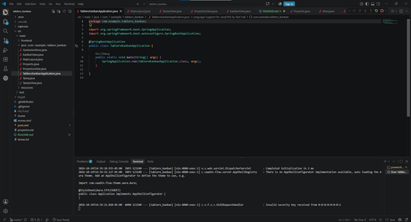
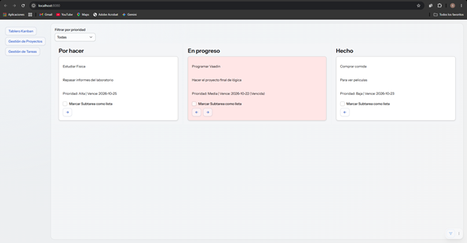
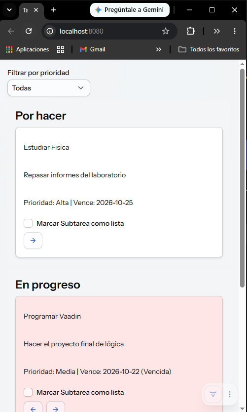
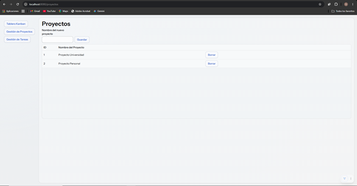
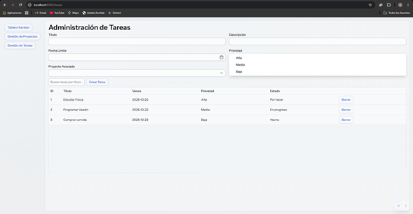

# Proyecto: Tablero Kanban 
Estudiante: Santiago Quintero Álvarez
Fecha: Noviembre 2026

## Descripción
Aplicación web responsiva de un Tablero Kanban. Esta web permite gestionar proyectos y tareas, contando con las funciones para añadir y eliminar. Toda la información se guarda mediante archivos `.txt` (separados por `|`), además, carga datos de prueba en el primer arranque si los archivos no existen.

## Componentes Investigados
Card: Implementado en `KanbanView` mediante un `VerticalLayout` estilizado con bordes redondeados y sombra.
Checkbox: Implementado dentro de cada tarjeta para marcar subtareas como completadas.
Select: Utilizado en `TareasView` para asociar una tarea a un proyecto y definir prioridad, y en `KanbanView` como filtro de columnas.

## Bonificación
Se hizo la funcionalidad de Arrastrar y soltar:
1. A cada tarjeta se le asignó un `DragSource`, empaquetando el objeto `Tarea` en el `setDragData`.
2. A cada columna (`VerticalLayout`) se le asignó un `DropTarget`.
3. Al atrapar el evento (`DropListener`), se extrae el objeto `Tarea`, se le actualiza su atributo `estado` según la columna receptora, se sobrescribe en el archivo `.txt` y se refresca el layout.

- Para probarla, simplemente basta con arrastrar alguna de las tareas ya creadas hacia otra columna, y se puede evidenciar que al soltarla, esta adquiere el nuevo estado en el que la dejemos

## Manual de Uso
1. Ejecutar el proyecto.
Ejecutar dandole click a run en TableroKanbanApplication

2. Abrir el navegador en `http://localhost:8080`.
Al abrir, se mostrará la aplicación

3. Navegar en el menú lateral responsivo a la creación de Proyectos, Tareas y luego manipularlas en el Tablero.

